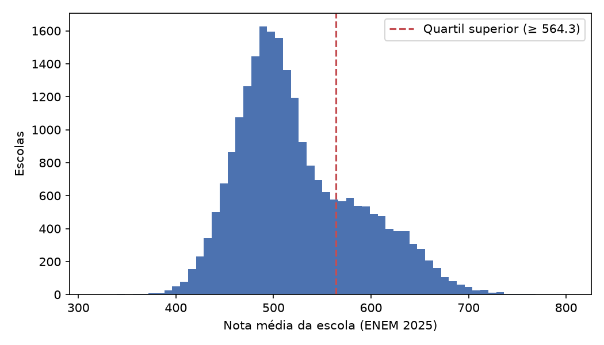
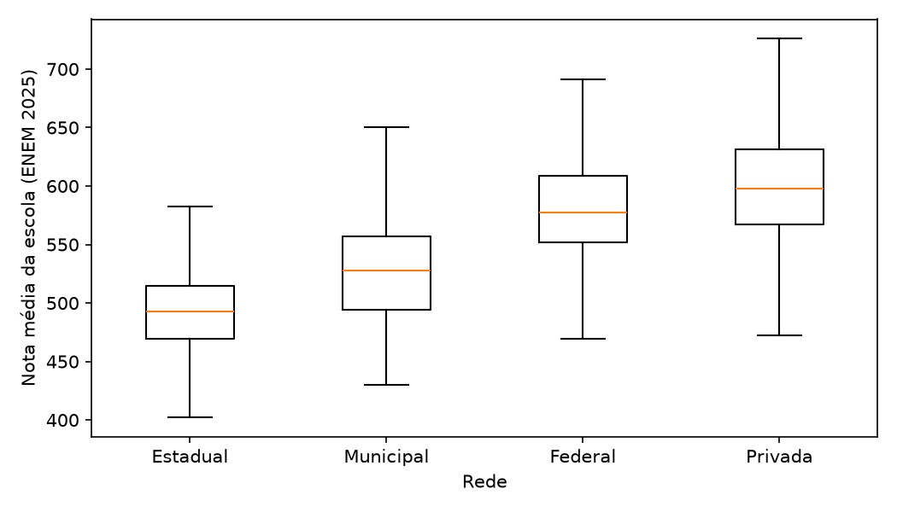
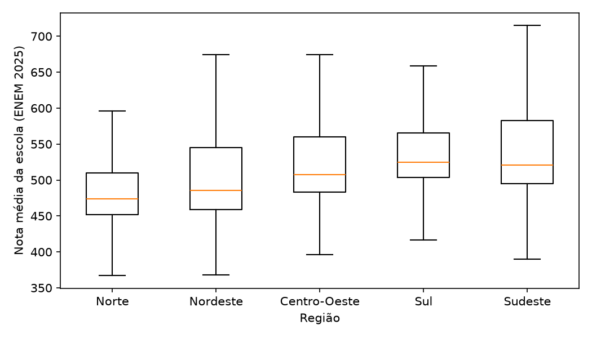
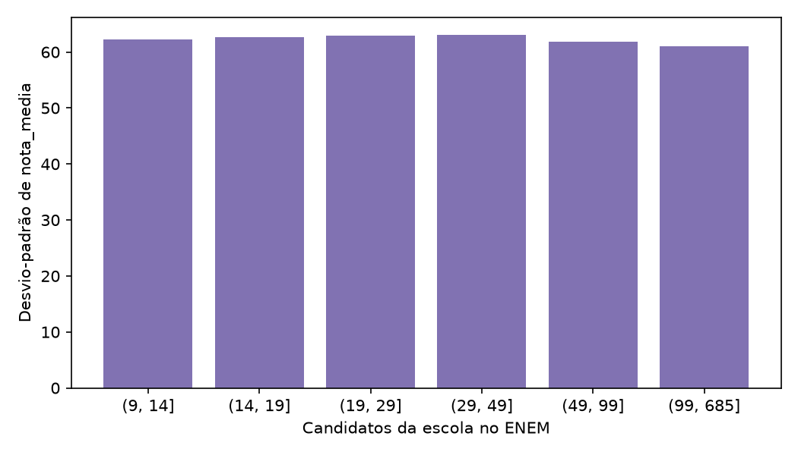
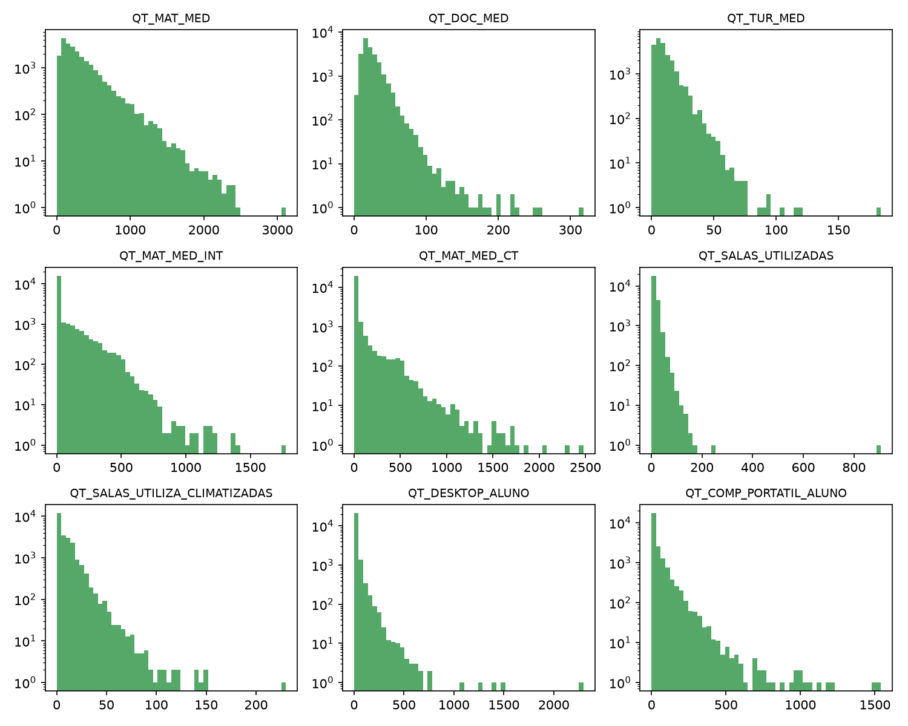
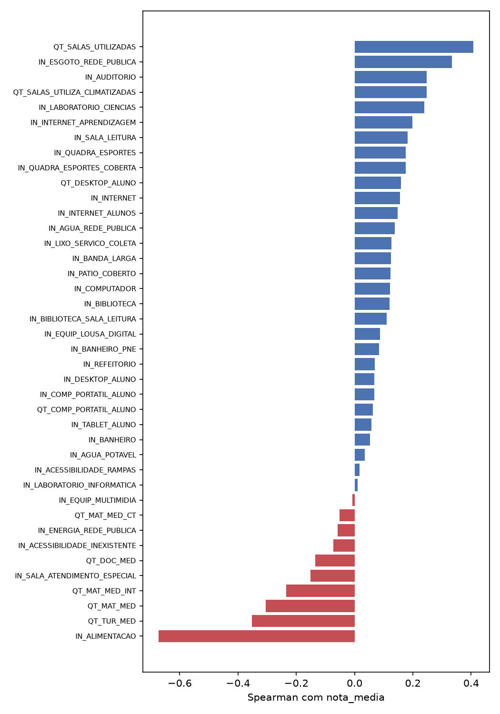

# EDA — tabela por escola (ENEM 2025 + Censo Escolar 2024)

Gerado por `scripts/eda.py` a partir de `data/processed/schools_enem2025_censo2024.parquet`. Todos os números deste arquivo saem do script; a interpretação fica para o grupo.

## Dados

- Escolas: **23,374** (99.2% das 23,570 escolas com ≥ 10 candidatos no ENEM).
- Candidatos válidos: 1,288,485.
- Atributos: 45; chaves de agrupamento (não são atributos): CO_MUNICIPIO, CO_UF.

| grupo                               |   atributos |
|:------------------------------------|------------:|
| Infraestrutura (binária, IN_*)      |          31 |
| Tamanho e recursos (contagem, QT_*) |           9 |
| Rede e localização (categórica)     |           5 |

## Alvo

|            |   count |   mean |   std |   min |   25% |   50% |   75% |   max |
|:-----------|--------:|-------:|------:|------:|------:|------:|------:|------:|
| nota_media | 23374.0 |  524.7 |  62.4 | 315.3 | 480.4 | 510.7 | 564.3 | 801.3 |

- Assimetria: 0.674.
- Quartil superior (alternativa de classificação): `nota_media` ≥ 564.3, 25.0% das escolas (desbalanceamento 1:3).

### Por rede (`TP_DEPENDENCIA`)

| TP_DEPENDENCIA   |   escolas |   media |   desvio |   mediana |
|:-----------------|----------:|--------:|---------:|----------:|
| Estadual         |   16248.0 |   492.9 |     36.5 |     492.8 |
| Municipal        |      84.0 |   526.5 |     47.7 |     527.7 |
| Federal          |     600.0 |   580.5 |     42.4 |     577.1 |
| Privada          |    6442.0 |   599.4 |     46.6 |     597.6 |

### Por região e localização

| CO_REGIAO    |   escolas |   media |   desvio |   mediana |
|:-------------|----------:|--------:|---------:|----------:|
| Norte        |    1952.0 |   488.2 |     58.0 |     474.0 |
| Nordeste     |    6185.0 |   504.6 |     63.7 |     485.3 |
| Centro-Oeste |    1884.0 |   523.8 |     59.0 |     507.2 |
| Sul          |    3456.0 |   538.1 |     50.1 |     524.8 |
| Sudeste      |    9897.0 |   539.9 |     60.5 |     521.1 |

| TP_LOCALIZACAO   |   escolas |   media |   desvio |   mediana |
|:-----------------|----------:|--------:|---------:|----------:|
| Rural            |    1474.0 |   474.3 |     48.6 |     469.8 |
| Urbana           |   21900.0 |   528.1 |     61.8 |     513.2 |

### Ruído da média por tamanho da escola

| n_alunos   |   escolas |   desvio |
|:-----------|----------:|---------:|
| (9, 14]    |    3049.0 |     62.3 |
| (14, 19]   |    2556.0 |     62.7 |
| (19, 29]   |    4102.0 |     63.0 |
| (29, 49]   |    5085.0 |     63.1 |
| (49, 99]   |    5370.0 |     61.8 |
| (99, 685]  |    3212.0 |     61.0 |

## Valores faltantes

- Atributos com algum faltante: 41 de 45; máximo 1.95% (`IN_BANDA_LARGA`).
- Escolas com pelo menos um faltante: 456.

|                               |   faltantes |
|:------------------------------|------------:|
| IN_BANDA_LARGA                |      0.0195 |
| IN_AGUA_REDE_PUBLICA          |      0.0008 |
| IN_ENERGIA_REDE_PUBLICA       |      0.0008 |
| IN_ESGOTO_REDE_PUBLICA        |      0.0008 |
| IN_AGUA_POTAVEL               |      0.0008 |
| IN_BANHEIRO                   |      0.0008 |
| IN_BANHEIRO_PNE               |      0.0008 |
| IN_ALIMENTACAO                |      0.0008 |
| IN_REFEITORIO                 |      0.0008 |
| IN_BIBLIOTECA                 |      0.0008 |
| IN_BIBLIOTECA_SALA_LEITURA    |      0.0008 |
| IN_SALA_LEITURA               |      0.0008 |
| IN_LIXO_SERVICO_COLETA        |      0.0008 |
| IN_LABORATORIO_CIENCIAS       |      0.0008 |
| IN_LABORATORIO_INFORMATICA    |      0.0008 |
| IN_QUADRA_ESPORTES            |      0.0008 |
| IN_AUDITORIO                  |      0.0008 |
| IN_PATIO_COBERTO              |      0.0008 |
| IN_SALA_ATENDIMENTO_ESPECIAL  |      0.0008 |
| IN_ACESSIBILIDADE_RAMPAS      |      0.0008 |
| IN_QUADRA_ESPORTES_COBERTA    |      0.0008 |
| IN_COMPUTADOR                 |      0.0008 |
| IN_DESKTOP_ALUNO              |      0.0008 |
| IN_COMP_PORTATIL_ALUNO        |      0.0008 |
| IN_TABLET_ALUNO               |      0.0008 |
| IN_EQUIP_MULTIMIDIA           |      0.0008 |
| IN_EQUIP_LOUSA_DIGITAL        |      0.0008 |
| IN_INTERNET                   |      0.0008 |
| IN_ACESSIBILIDADE_INEXISTENTE |      0.0008 |
| IN_INTERNET_ALUNOS            |      0.0008 |
| IN_INTERNET_APRENDIZAGEM      |      0.0008 |
| QT_MAT_MED                    |      0.0008 |
| QT_DOC_MED                    |      0.0008 |
| QT_TUR_MED                    |      0.0008 |
| QT_MAT_MED_INT                |      0.0008 |
| QT_MAT_MED_CT                 |      0.0008 |
| QT_SALAS_UTILIZADAS           |      0.0008 |
| QT_SALAS_UTILIZA_CLIMATIZADAS |      0.0008 |
| QT_DESKTOP_ALUNO              |      0.0008 |
| QT_COMP_PORTATIL_ALUNO        |      0.0008 |
| TP_LOCALIZACAO_DIFERENCIADA   |      0.0008 |

## Atributos binários (infraestrutura)

Proporção de escolas com o recurso:

|                               |   proporção |
|:------------------------------|------------:|
| IN_ACESSIBILIDADE_INEXISTENTE |       0.175 |
| IN_EQUIP_LOUSA_DIGITAL        |       0.355 |
| IN_AUDITORIO                  |       0.361 |
| IN_TABLET_ALUNO               |       0.374 |
| IN_SALA_LEITURA               |       0.389 |
| IN_SALA_ATENDIMENTO_ESPECIAL  |       0.407 |
| IN_LABORATORIO_CIENCIAS       |       0.556 |
| IN_REFEITORIO                 |       0.591 |
| IN_COMP_PORTATIL_ALUNO        |       0.667 |
| IN_QUADRA_ESPORTES_COBERTA    |       0.684 |
| IN_PATIO_COBERTO              |       0.700 |
| IN_ACESSIBILIDADE_RAMPAS      |       0.713 |
| IN_LABORATORIO_INFORMATICA    |       0.729 |
| IN_BIBLIOTECA                 |       0.730 |
| IN_ALIMENTACAO                |       0.742 |
| IN_ESGOTO_REDE_PUBLICA        |       0.747 |
| IN_DESKTOP_ALUNO              |       0.774 |
| IN_INTERNET_ALUNOS            |       0.782 |
| IN_BANHEIRO_PNE               |       0.788 |
| IN_QUADRA_ESPORTES            |       0.814 |
| IN_EQUIP_MULTIMIDIA           |       0.843 |
| IN_INTERNET_APRENDIZAGEM      |       0.844 |
| IN_BIBLIOTECA_SALA_LEITURA    |       0.903 |
| IN_BANDA_LARGA                |       0.909 |
| IN_AGUA_REDE_PUBLICA          |       0.919 |
| IN_LIXO_SERVICO_COLETA        |       0.981 |
| IN_INTERNET                   |       0.981 |
| IN_COMPUTADOR                 |       0.984 |
| IN_AGUA_POTAVEL               |       0.991 |
| IN_ENERGIA_REDE_PUBLICA       |       0.994 |
| IN_BANHEIRO                   |       0.994 |

- Quase constantes (< 2% ou > 98%): `IN_LIXO_SERVICO_COLETA`, `IN_INTERNET`, `IN_COMPUTADOR`, `IN_AGUA_POTAVEL`, `IN_ENERGIA_REDE_PUBLICA`, `IN_BANHEIRO`.

## Atributos de contagem (escala e outliers)

O Censo marca valores extremos com o código 88888 (dicionário de dados: "registro com marcação de valor extremo"). Esses registros ficam fora das estatísticas de escala e são contados na coluna `marcados_88888`.

Verificação contra as fontes originais (16/10/2026):

- **Fonte oficial:** INEP, *Microdados do Censo Escolar da Educação Básica 2024*, Anexo I – Dicionário de Dados, aba `microdados_unidade_coleta`, linhas 215 (`QT_DESKTOP_ALUNO`) e 217 (`QT_COMP_PORTATIL_ALUNO`): "88888 - registro com marcação de valor extremo (valor superior ao limite máximo de 4 equipamentos para cada 3 matrículas - foram marcados apenas valores>3)". O zip usado é idêntico ao publicado pelo INEP (SHA-256 no `.json` de metadados).
- **CSV completo do Censo (215.545 escolas):** o código aparece em 26 colunas `QT_` (computadores, equipamentos e profissionais) e nenhum outro valor chega a 10.000; as escolas marcadas são pequenas (mediana de 12 a 19 matrículas).
- **Limitação:** o limite de 4 equipamentos para cada 3 matrículas não se reproduz com as colunas públicas: entre 17 e 42 escolas sem marca (conforme a contagem de matrículas usada) ficam acima dele. Ou seja, nem todo valor extremo está marcado.
- **Tratamento:** decisão do grupo (faltante com imputação, ou faltante + indicador binário de valor extremo marcado).

| atributo                      |   mediana |     p99 |   máximo |   assimetria |   zeros |   outliers_iqr |   marcados_88888 |
|:------------------------------|----------:|--------:|---------:|-------------:|--------:|---------------:|-----------------:|
| QT_MAT_MED                    |    230.00 | 1351.46 |  3116.00 |         2.09 |    0.01 |           0.05 |             0.00 |
| QT_DOC_MED                    |     20.00 |   73.00 |   318.00 |         3.24 |    0.01 |           0.04 |             0.00 |
| QT_TUR_MED                    |      8.00 |   41.00 |   184.00 |         2.63 |    0.01 |           0.06 |             0.00 |
| QT_MAT_MED_INT                |      1.00 |  551.46 |  1776.00 |         2.70 |    0.50 |           0.12 |             0.00 |
| QT_MAT_MED_CT                 |      0.00 |  597.46 |  2478.00 |         5.62 |    0.78 |           0.22 |             0.00 |
| QT_SALAS_UTILIZADAS           |     13.00 |   59.00 |   906.00 |        18.35 |    0.00 |           0.06 |             0.00 |
| QT_SALAS_UTILIZA_CLIMATIZADAS |      4.00 |   48.00 |   230.00 |         3.13 |    0.43 |           0.03 |             0.00 |
| QT_DESKTOP_ALUNO              |     12.00 |  185.00 |  2297.00 |        14.77 |    0.23 |           0.06 |            11.00 |
| QT_COMP_PORTATIL_ALUNO        |      4.00 |  274.00 |  1540.00 |         6.50 |    0.33 |           0.11 |             4.00 |

## Correlação com o alvo (Spearman)

|                               |   spearman |
|:------------------------------|-----------:|
| IN_ALIMENTACAO                |     -0.672 |
| QT_TUR_MED                    |     -0.352 |
| QT_MAT_MED                    |     -0.305 |
| QT_MAT_MED_INT                |     -0.234 |
| IN_SALA_ATENDIMENTO_ESPECIAL  |     -0.151 |
| QT_DOC_MED                    |     -0.135 |
| IN_ACESSIBILIDADE_INEXISTENTE |     -0.073 |
| IN_ENERGIA_REDE_PUBLICA       |     -0.058 |
| QT_MAT_MED_CT                 |     -0.052 |
| IN_EQUIP_MULTIMIDIA           |     -0.007 |
| IN_LABORATORIO_INFORMATICA    |      0.010 |
| IN_ACESSIBILIDADE_RAMPAS      |      0.017 |
| IN_AGUA_POTAVEL               |      0.035 |
| IN_BANHEIRO                   |      0.052 |
| IN_TABLET_ALUNO               |      0.058 |
| QT_COMP_PORTATIL_ALUNO        |      0.063 |
| IN_COMP_PORTATIL_ALUNO        |      0.067 |
| IN_DESKTOP_ALUNO              |      0.068 |
| IN_REFEITORIO                 |      0.069 |
| IN_BANHEIRO_PNE               |      0.084 |
| IN_EQUIP_LOUSA_DIGITAL        |      0.087 |
| IN_BIBLIOTECA_SALA_LEITURA    |      0.111 |
| IN_BIBLIOTECA                 |      0.120 |
| IN_COMPUTADOR                 |      0.121 |
| IN_PATIO_COBERTO              |      0.122 |
| IN_BANDA_LARGA                |      0.125 |
| IN_LIXO_SERVICO_COLETA        |      0.127 |
| IN_AGUA_REDE_PUBLICA          |      0.137 |
| IN_INTERNET_ALUNOS            |      0.148 |
| IN_INTERNET                   |      0.156 |
| QT_DESKTOP_ALUNO              |      0.160 |
| IN_QUADRA_ESPORTES_COBERTA    |      0.175 |
| IN_QUADRA_ESPORTES            |      0.176 |
| IN_SALA_LEITURA               |      0.182 |
| IN_INTERNET_APRENDIZAGEM      |      0.198 |
| IN_LABORATORIO_CIENCIAS       |      0.239 |
| QT_SALAS_UTILIZA_CLIMATIZADAS |      0.248 |
| IN_AUDITORIO                  |      0.248 |
| IN_ESGOTO_REDE_PUBLICA        |      0.334 |
| QT_SALAS_UTILIZADAS           |      0.408 |

### Pares de atributos muito correlacionados (|Spearman| ≥ 0,8)

|                                                      |   spearman |
|:-----------------------------------------------------|-----------:|
| ('QT_MAT_MED', 'QT_TUR_MED')                         |      0.956 |
| ('IN_COMP_PORTATIL_ALUNO', 'QT_COMP_PORTATIL_ALUNO') |      0.832 |

## Inconsistências

| rule                                                  |   schools |
|:------------------------------------------------------|----------:|
| high school enrolment > 0 but no high school teachers |         0 |
| high school enrolment is zero                         |       253 |
| air-conditioned rooms > rooms in use                  |         0 |
| broadband without internet                            |         0 |
| ENEM candidates > high school enrolment               |       276 |
| INEP extreme-value code 88888 in a count              |        15 |
